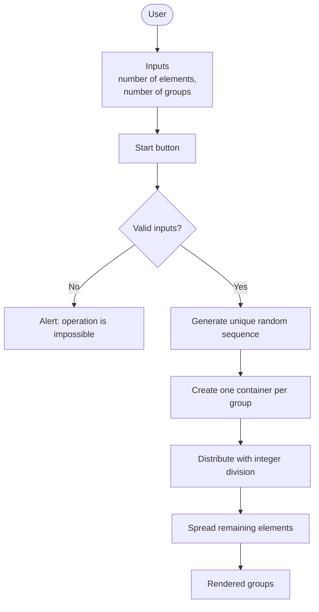
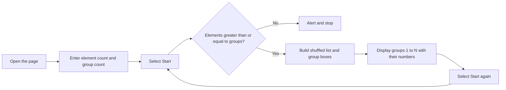

<div align="center">


<p><strong>A small utility that shuffles a numbered list and distributes it into balanced, non-repeating groups.</strong></p>

</div>

<div align="center">

<a href="https://github.com/mohammed-laabidi/Dividing-the-group"></a>
<a href="https://github.com/mohammed-laabidi/Dividing-the-group/fork"></a>
<a href="https://github.com/mohammed-laabidi/Dividing-the-group/issues"></a>


</div>

<div align="center">

<a href="https://mohammed-laabidi.github.io/Dividing-the-group/"><strong>Live Demo</strong></a>
&nbsp;&nbsp;|&nbsp;&nbsp;
<a href="https://github.com/mohammed-laabidi/Dividing-the-group">Repository</a>

</div>

## Overview

Dividing the Group answers a recurring classroom and workshop question: how to split a known number of participants into a requested number of teams without bias. The user enters the total number of elements and the number of groups, and the page produces randomly ordered groups of equal size.

The generator builds a shuffled sequence of unique numbers, then distributes it in two passes. A first pass assigns the same number of elements to each group using integer division; a second pass spreads the remainder across the first groups so no element is lost. Every group is rendered inside its own container with a numbered heading.

The tool is self-contained and stateless: nothing is stored, and each run produces a new random distribution.

## Features

<table>
<tr>
<td width="50%" valign="top">


### Random and unique elements

The element sequence is generated randomly and checked for duplicates, so an element never appears twice.

</td>
<td width="50%" valign="top">


### Balanced distribution

Each group receives the same base count, and leftover elements are assigned one by one to the first groups.

</td>
</tr>
<tr>
<td width="50%" valign="top">


### Input validation

The operation is refused, with an alert, when the numbers are missing, zero or negative, or when the number of groups exceeds the number of elements.

</td>
<td width="50%" valign="top">


### Instant regeneration

Every click on Start clears the previous result and renders a fresh distribution.

</td>
</tr>
</table>

## Technology Stack

<div align="center">


</div>

| Technology | Purpose |
| --- | --- |
| HTML5 | Input fields, result container, and footer |
| CSS3 | Group cards, layout, and two responsive breakpoints |
| JavaScript | Shuffling, distribution, validation, and rendering |
| GitHub Pages | Static hosting of the live demo |

## Architecture

The project is a single page with no dependencies. The script owns all the logic and writes the resulting group boxes directly into the document.



## Application Flow



## Project Structure

```text
Dividing-the-group/
├── index.html
├── style.css
├── script.js
└── README.md
```

## Getting Started

### Prerequisites

A modern browser. No dependencies or build step are required.

### Installation

```bash
git clone https://github.com/mohammed-laabidi/Dividing-the-group.git
cd Dividing-the-group
```

Open `index.html` in a browser, or serve the folder locally:

```bash
python -m http.server 8000
```

## Usage

1. Enter the total number of elements in the first field.
2. Enter the number of groups in the second field.
3. Select Start. The groups appear below the form with a heading per group.
4. Select Start again to generate a different distribution.

The split is computed in two steps: `Math.trunc(elements / groups)` elements per group, then the remainder is added one by one to the first groups. For example, 28 elements in 5 groups produce three groups of 6 and two groups of 5.

## Deployment

The live demo is published with GitHub Pages from the repository root. Any static host can serve the three files directly.

## Author

<table>
<tr>
<td valign="top">

**Mohammed Laabidi**

<a href="https://github.com/mohammed-laabidi"> GitHub</a>
&nbsp;&nbsp;
<a href="https://www.linkedin.com/in/mohammed-laabidi-793a40436"> LinkedIn</a>
&nbsp;&nbsp;
<a href="mailto:mohammedlaabidi19@gmail.com"> Email</a>

</td>
</tr>
</table>

---

If this project is useful to you, consider giving the repository a star.
